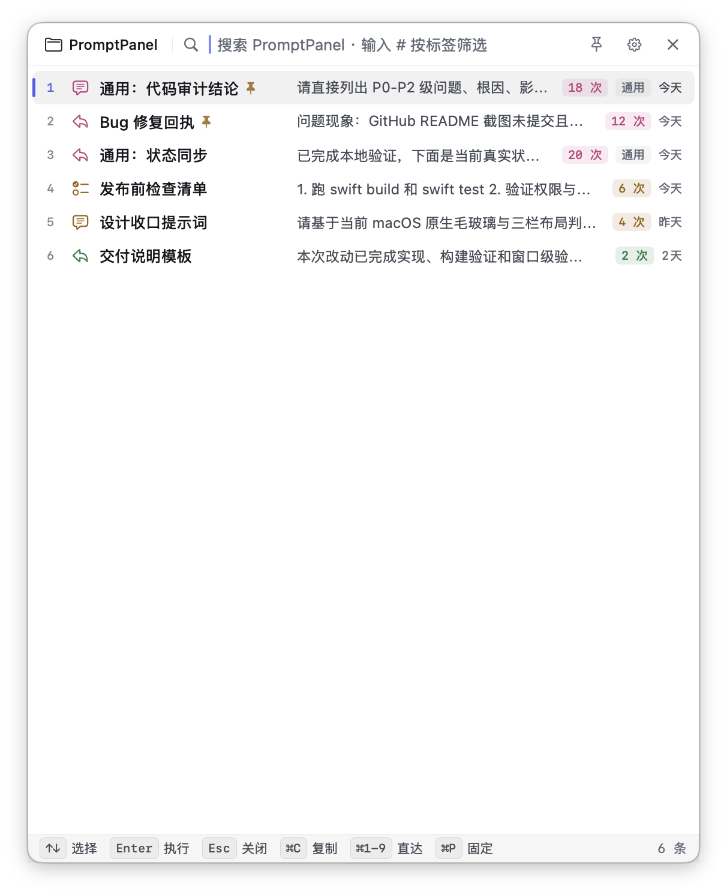
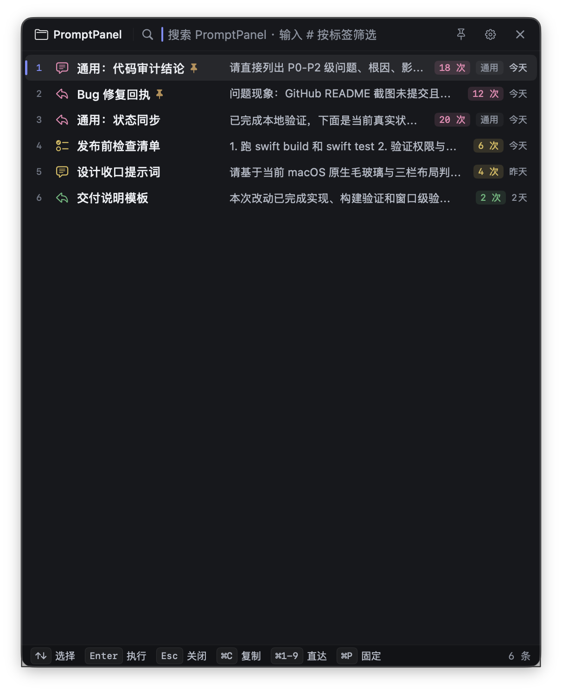
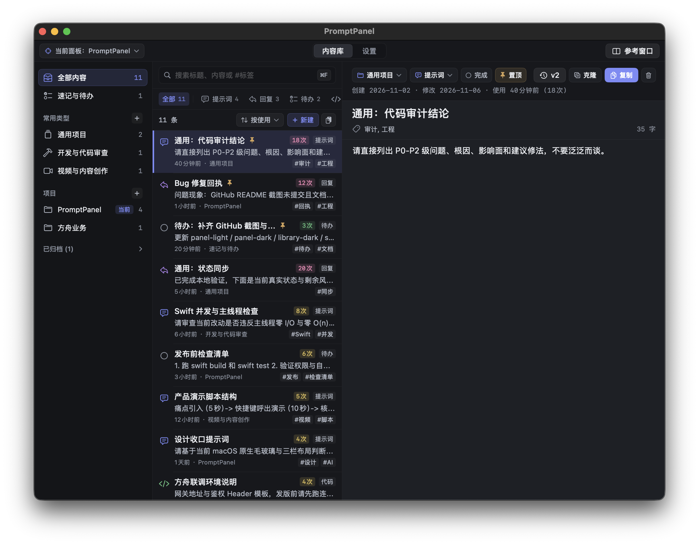
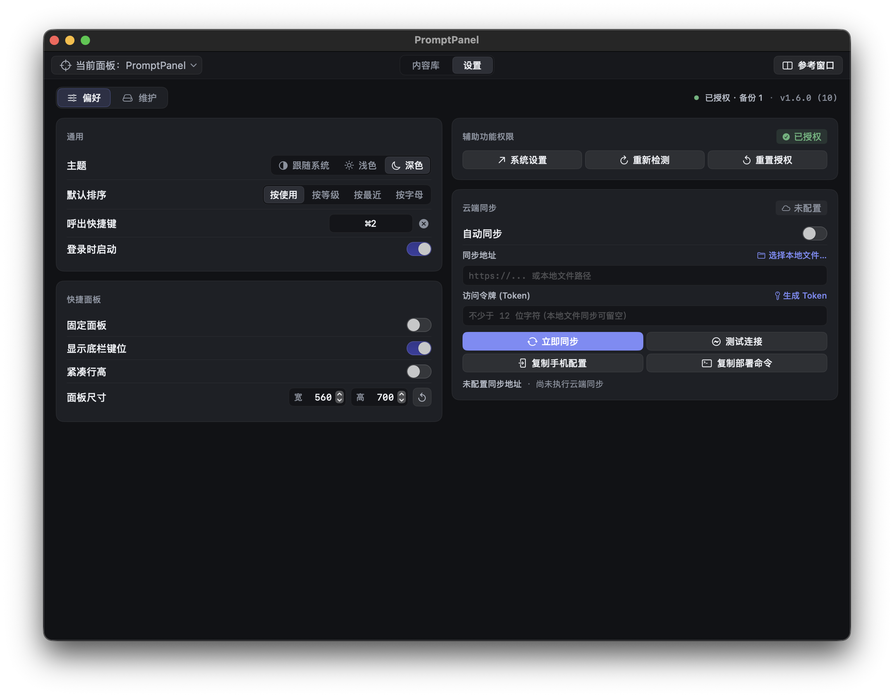

<div align="center">


# PromptPanel | 项目快贴

[English](README.md) · [**简体中文**](README.zh-CN.md) · [繁體中文](README.zh-TW.md) · [日本語](README.ja.md) · [한국어](README.ko.md) · [Español](README.es.md) · [Français](README.fr.md) · [Deutsch](README.de.md)

### 面向 ChatGPT、Claude、Cursor、Copilot、VS Code 和终端的 macOS 原生 Prompt 管理器 / 代码片段启动器
### Native macOS prompt manager and snippet launcher for AI workflows

PromptPanel 是一款本地优先的 **macOS Prompt 管理器**、**AI Prompt 启动器** 和 **代码片段启动器**：全局快捷键唤出快捷面板，瞬间检索你的 **Prompt 库 / 代码片段 / 模板**，把内容一键送进 **ChatGPT、Claude、Cursor、Copilot、VS Code、终端、浏览器或任意输入框**。

[](https://github.com/qilaidev/PromptPanel/actions/workflows/macos-release-readiness.yml)
[](CHANGELOG.md)
[](https://opensource.org/licenses/MIT)
[](https://www.apple.com/macos)
[](https://swift.org)
[](#安装)
[](#隐私与数据)
[](.github/CONTRIBUTING.md)

[**FAQ**](docs/FAQ.md) · [**文档**](docs/README.md) · [**LLM 索引**](llms.txt) · [**CodeMeta**](codemeta.json) · [**Schema.org**](docs/search-metadata.schema.jsonld) · [**变更记录**](CHANGELOG.md) · [**贡献指南**](.github/CONTRIBUTING.md)

</div>

---

## 30 秒判断

| 维度 | 结论 |
|---|---|
| 项目类型 | 开源、本地优先的 macOS Prompt manager / AI prompt launcher / snippet launcher。 |
| 核心问题 | 解决高频复制粘贴同一批 ChatGPT、Claude、Cursor、Copilot、VS Code、Terminal Prompt、项目上下文、命令片段和模板的问题。 |
| 适合人群 | AI 重度用户、开发者、Prompt engineers、技术写作者、PM、顾问、需要按项目隔离 Prompt 库的独立开发者。 |
| 核心功能 | 全局快捷键、即时搜索（SQLite FTS5 + 子串匹配）、三层工作区（`速记与待办` / `常用类型` / `项目管理` + 项目归档）、双窗参考与剪贴板装配台（`参考窗口`）、词条历史版本与一键回滚、`#tag` 过滤、frecency 智能排序、剪贴板优先、辅助功能权限下自动粘贴、执行日志、JSON/Markdown 导入导出、可选开源自托管多端同步（`server/` + `mobile/`）。 |
| 技术栈 | Swift 5.10、AppKit `NSPanel`、SwiftUI、SQLite/GRDB、KeyboardShortcuts、Sparkle 2、Swift Package Manager（另附可选 Python 自托管同步服务与 Flutter 移动端）。 |
| 快速开始 | `git clone` → `./scripts/build-app.sh` → `open dist/PromptPanel.app`。首次运行建议授予辅助功能权限；不授权也能复制到剪贴板。 |
| 典型场景 | ChatGPT/Claude role prompt、Cursor project context、PR review checklist、terminal command snippet、会议纪要模板、客户回复模板、跨端速记与待办。 |
| 界面语言 | 应用界面目前只有**简体中文**（`CFBundleDevelopmentRegion = zh-Hans`，无本地化资源与语言切换入口）。文档为中英双语、共 8 个语言版本。词条内容本身不限语言。 |
| 限制边界 | 桌面端仅支持 macOS 14+；界面仅简体中文；当前 Release 暂无已公证二进制包；默认纯本地零网络请求（可选多端同步需自行配置本地网盘路径或自托管服务端）；无多人团队协作、无工作流编排；暂不支持变量模板；自动粘贴依赖 macOS Accessibility。 |

## 界面截图 / Screenshots

<table>
  <tr>
    <td width="50%"></td>
    <td width="50%"></td>
  </tr>
  <tr>
    <td align="center"><sub>快捷面板（浅色）— 快捷键 → 搜索 → Enter</sub></td>
    <td align="center"><sub>快捷面板（深色）— 560 × 700 竖版启动器</sub></td>
  </tr>
  <tr>
    <td width="50%"></td>
    <td width="50%"></td>
  </tr>
  <tr>
    <td align="center"><sub>内容库 — 项目、词条、预览三栏</sub></td>
    <td align="center"><sub>设置 — 快捷键、主题、权限、维护</sub></td>
  </tr>
</table>

<sub>由 `./scripts/capture-ui-qa.sh` 生成。应用界面目前仅简体中文。</sub>

## PromptPanel 是什么？

**PromptPanel（项目快贴）** 是一款开源的 **macOS 原生 Prompt 管理工具 / 片段启动器**，专门围绕 AI 用户的真实工作流设计。在任何前台应用里——不管是 ChatGPT、Claude、Cursor、VS Code、终端，还是浏览器——按下你设置的全局快捷键，一个轻量面板立刻浮现。打几个字、回车，内容就落进当前输入框。**不需要账号、不上云、不依赖任何同步服务。** 你的所有 Prompt 都只在这台 Mac 上。

English positioning: **PromptPanel is a native macOS prompt manager, AI prompt launcher, local-first prompt library, and snippet launcher** for ChatGPT, Claude, Cursor, Copilot, VS Code, Terminal, browsers, and ordinary macOS text fields.

如果你正在找 **AI Prompt 库**、**TextExpander 替代品（专门为 Prompt 用的）**、**macOS 开源 snippet launcher**，或者想停止把同一段指令一天复制粘贴一百遍到 Claude / ChatGPT 里——这就是 PromptPanel 要解决的问题。

常见搜索词也能对应到它：**ChatGPT Prompt 管理 macOS**、**Claude Prompt 库**、**Cursor 代码片段管理器**、**本地优先 Prompt 库**、**全局快捷键粘贴工具**、**Raycast Snippets 的 AI Prompt 替代方案**、**开源 TextExpander 替代品**。

## 是不是听起来很熟？

PromptPanel 之所以存在，是因为高频 AI 使用者每天都会撞上同样的 5 件事：

- 每开一个新的 ChatGPT / Claude 会话，就要再敲一遍同样的 **角色 / system prompt**（"你是一位高级工程师…"）。
- 用备忘录或文本草稿堆 **AI Prompt + 代码评审清单**，每次 `⌘F` 翻一遍。
- 终于找到想要的 Prompt，焦点跳了或对方 app 屏蔽合成按键，**粘贴静默失败**。
- **Cursor / Copilot 的项目上下文**在一个文件，终端命令在另一个文件，PR 评审 Prompt 在第三个——没有一处能一起搜。
- 真正涉密的客户简报和架构细节，你不敢扔进 **云端 Prompt 管理器**，结果干脆没有"Prompt 管理器"。

PromptPanel 把上面这些全部塌进一条 sub-second 的链路——而你的数据始终在你本机的一个 SQLite 文件里。

## 为什么是 PromptPanel？

市面上的 "Prompt 管理工具" 要么是浏览器插件（只在一个网站里能用），要么是为通用打字加速设计的、并不贴合 AI 工作流。PromptPanel 围绕**唯一一条主链路**做：

> **快捷键 → 搜索 → 回车 → 内容进入当前输入框**

其他一切都为这条链路服务——快、可预期、永远不会"静默失败"。

| 你想要 | PromptPanel 给你 |
|---|---|
| 一个**任何应用都能用**的 Prompt 库，不限于某个网站 | 全局快捷键 + 原生 macOS 面板，任意输入框可用 |
| **低延迟原生链路**——按键到能输入的目标时间明确 | < 300 ms 唤出聚焦目标、< 50 ms 搜索刷新目标、< 180 ms 执行目标（即 `Constants.swift` 里的内部预算，超标会打 warning 日志） |
| **项目隔离**，A 客户的 Prompt 不会串到 B 项目里 | 一等公民的"项目"概念 + 内置不可删的 `通用项目` |
| 敏感 Prompt **不想上云** | 本地 SQLite，核心功能零网络调用，数据是一个你完全掌握的文件 |
| **自动粘贴不能静默失败** | 自动粘贴优先 + 剪贴板永远兜底，被屏蔽时有清晰提示 |
| 全键盘操作 | 唤出 → 输入 → 方向键 → 回车，从头到尾不用碰鼠标 |
| 可审计、可 fork、可信任的开源 | MIT 协议、纯 Swift 实现、零遥测 |

## 适合谁用？

- **重度 ChatGPT / Claude / Gemini 用户**：反复输入角色设定、输出格式约束、上下文模板的人
- **Cursor / Copilot / Aider 使用者**：常常要粘贴架构概要、代码评审清单
- **开发者**：经常需要插入提交说明模板、代码评审模板、终端命令、排障 snippet
- **独立开发者 / 顾问**：在多个客户项目间切换，每家有不同的风格指南、tone-of-voice
- **技术写作者 / PM**：维护可复用的回复、状态更新、规范脚手架

如果"我每天要把同一段多行 Prompt 重复输入二十遍"是在描述你——这工具就是为你写的。

## 功能一览

### 核心功能

- 🔥 **全局快捷键**：在任何前台应用里都能唤出，可自定义
- ⚡ **< 300 ms 主链路**：基于 `NSPanel` 启动预热，没有 Electron、没有 Web 运行时、没有冷启动
- 🔍 **即时混合搜索**：按标题、正文或标签实时过滤（SQLite FTS5 前缀匹配 + 大小写不敏感子串兜底 + `LIMIT` 前置 `#tag` 过滤），不需要点提交
- 🗂️ **三层工作区与项目归档**：划分为 `速记与待办`（内置收件箱，随手记待办并支持勾选完成）、`常用类型`（长期常驻不归档的通用/分类模板，含 `通用项目`）、`项目管理`（按客户或仓库隔离，结项后可一键归档隐藏）
- 🪟 **双窗对照与剪贴板装配台（`参考窗口`）**：主窗口旁一键打开独立参考窗，边看「常用类型」或系统剪贴板实时预览，边一键克隆到目标项目（记录 `source_entry_id`），在项目内修改绝不污染通用模板
- 🕰️ **词条版本历史与无损回滚（`EntryVersion`）**：每次修改词条标题或正文自动留存 `v1`、`v2` 等历史版本，随时查看任意历史版本或一键恢复
- 📋 **自动粘贴 + 剪贴板兜底**：用 `CGEvent` 模拟 ⌘V，权限缺失时优雅降级
- 🎯 **键盘优先**：方向键选择，回车执行，Esc 关闭；面板与内容库词条均支持右键菜单
- 📌 **置顶 + frecency 排序**：必须常驻的词条置顶；其余按 `使用次数 × 2^(-闲置天数 / 90)` 打分，高频词条自动上浮，久不使用的自然下沉
- 🌗 **浅色 / 深色 / 跟随系统**：采用 macOS 原生毛玻璃材质与系统语义色
- 🪶 **菜单栏常驻**：不打扰，要用就来
- 🚀 **开机启动**：基于 `SMAppService`
- 🔐 **权限缺失也能用**：没辅助功能权限时只走"复制"，UI 明确告知
- 📝 **多行内容**：模板正文不限长度
- 📊 **执行日志**：粘贴失败时可查
- ☁️ **可选的开源自托管多端同步（`CloudSyncService` + `server/` + `mobile/`）**：默认 100% 纯本地零网络请求；需要跨设备协同的用户可在「设置 → 偏好 → 云端同步」中配置本地网盘/iCloud 文件路径，或一键部署仓库自带的零外部依赖 Python 同步服务端（`server/`）与 Flutter 手机端（`mobile/`），并发冲突自动留存进历史版本
- 🔄 **手动更新（GitHub Releases）**：Sparkle 已接入但默认关闭；正式 appcast 托管位就绪后再开启自动检查

### 永远不会做（产品边界）

PromptPanel **永远不会**加入强制 SaaS 账号体系、多人团队协作、复杂工作流编排。这个工具的核心就是单用户、本地优先、轻量快速（多端同步仅作为完全由用户自托管/自控的可选增强）。详见 [PRD §4.2](docs/项目快贴-PRD.md)。

## 工作原理

```
   ┌──────────────┐    快捷键      ┌──────────────┐    回车       ┌──────────────┐
   │  任意应用     │  ──────────►  │ PromptPanel  │  ──────────► │   剪贴板      │
   │  ChatGPT     │   （全局）     │   NSPanel    │  （执行）     │   写入        │
   │  Claude      │               │              │              └──────┬───────┘
   │  Cursor……    │ ◄──────────── │              │                     │
   └──────────────┘   面板退场     └──────────────┘                     │
          ▲           前台焦点恢复                                       │
          └────────── CGEvent ⌘V （需辅助功能权限） ◄──────────────────┘
                          失败时：仅剪贴板 + Toast 提示
```

1. 你按下设置的快捷键（`KeyboardShortcuts` 在系统层捕获）
2. PromptPanel 把 `NSPanel` 弹到当前窗口上方，自动聚焦搜索框，按「置顶 → frecency 得分 → 最近使用 → 使用次数」展示当前项目 + `通用项目` 词条
3. 你打字过滤（实时，无需提交），方向键选择，回车
4. **永远先把内容写进系统剪贴板**——这是产品的硬承诺，剪贴板这一步绝不静默失败
5. 面板退场，前一个 app 恢复焦点，PromptPanel 用 `CGEvent` 合成一次 `⌘V`。如果辅助功能权限缺失或目标 app 屏蔽合成事件，会有 Toast 告诉你"已复制，按 ⌘V 粘贴即可"
6. 执行结果会写日志，方便你后续排查特定 app 的兼容性问题

**剪贴板是承诺，自动粘贴是尽力而为**——这是整个项目最重要的设计决定。

## 安装

> **系统要求**：macOS 14 (Sonoma) 及以上，Apple Silicon 与 Intel 都支持。

### 方式 A · 从源码构建（当前推荐）

```bash
# 1. 克隆
git clone https://github.com/qilaidev/PromptPanel.git
cd PromptPanel

# 2. 打 .app 包（默认 ad-hoc 签名）
./scripts/build-app.sh

# 3. 直接运行，或拖进 /Applications
open dist/PromptPanel.app
```

构建依赖：

- Xcode 15+（含 macOS 14 SDK）
- Swift 5.10 工具链（`xcrun swift --version` 检查）

### 方式 B · 已签名 / 已公证的发布版

当前 GitHub Releases 只承载源码 / 文档发布说明，尚未附带公证二进制产物。Developer ID 公证链路补齐前，先用 `./scripts/build-app.sh` 本地构建。

### 首次运行

1. **授予辅助功能权限**：用于合成 `⌘V` 模拟按键。不授予也能用，只是主链路停在剪贴板那一步、需要你手动粘贴
2. **设置快捷键**：当前默认是 `⌥2`；如果与你自己的快捷键冲突，可以在设置里改掉
3. **新建一个项目**或者直接往 `通用项目` 里加词条

## 快速上手

假设 `.app` 已构建并运行（菜单栏能看到图标）：

```text
1. 打开主窗口 → 内容库 → 新建第一条词条：
   标题填 "review"，正文粘你的代码评审 Prompt，可选填标签
2. ⌥2             → 面板浮现，搜索框自动聚焦
3. 输入 "review"  → 过滤到你的代码评审模板
4. ↵              → 先写剪贴板，再粘贴进当前输入框
5. （面板退场）    → 继续手头工作
```

### 面板内的搜索语法

| 你输入 | 实际行为 |
|---|---|
| `review` | 对词条标题、正文和标签做 SQLite **FTS5 前缀匹配 + 大小写不敏感子串匹配（`INSTR`）** |
| `code rev` | 空格分隔的每个 token 都是 AND 关系，同时支持英文前缀与中文连写串中段词召回 |
| `#sql` | 只保留打了 `sql` 标签的词条（在 SQL `LIMIT 100` 截断前完成过滤）；`#tag` 这个 token 会从文本查询里剔除 |
| `#sql migrate` | 标签 `sql` **且** 文本命中 `migrate` |
| *(空)* | 浏览「当前项目 + 通用项目」，按 置顶 → frecency → 最近使用 → 使用次数 排列 |

注意：一次查询只取**第一个** `#tag` 作为标签过滤，且标签是**精确、区分大小写**匹配（`#SQL` 匹配不到 `sql` 标签）；搜索结果上限 100 条；查询结合了 FTS5 前缀索引与 `INSTR` 子串匹配，因此在“并发安全”里搜“安全”也能直接命中。

切换当前项目可以直接在面板内完成，不必打开主窗口——纯键盘，零绕路。

### 键盘快捷键 / Keyboard shortcuts

| 按键 | 位置 | 作用 |
|---|---|---|
| `⌥2`（默认，可改） | 全局 | 呼出／收起快捷面板，同一组合键切换 |
| `↑` / `↓` | 面板 | 上下移动选中项 |
| `↵` | 面板 | 执行：先写入剪贴板，再尽力自动粘贴 |
| `⌘1`–`⌘9` | 面板 | 直达执行第 N 行（搜索框为空时显示序号） |
| `⌘C` | 面板 | 仅复制选中词条，不粘贴 |
| `⌘P` | 面板 | 固定面板（失焦不再自动关闭） |
| `Esc` / `✕` | 面板 | 关闭面板 |
| `⌘F` | 主窗口 | 聚焦内容库搜索框 |
| `⌘N` | 主窗口 | 新建词条 |
| `↑` / `↓` | 主窗口 | 上下移动内容库选中词条 |
| `⇧⌘C` | 主窗口 | 复制选中词条（普通 `⌘C` 留给可选中的预览区） |
| `⌘E` | 主窗口 | 编辑选中词条 |


## 配置

| 设置项 | 位置 | 说明 |
|---|---|---|
| 全局快捷键 | `设置 → 偏好 → 快捷键 → 呼出面板` | 只有这一个快捷键，默认 `⌥2`；同一组合再按一次会关闭面板 |
| 主题 | `设置 → 偏好 → 外观 → 主题` | 浅色 / 深色 / 跟随系统 |
| 词条排序 | `设置 → 偏好 → 词条排序` | 按使用 / 按等级 / 按最近 / 按字母 |
| 面板行为 | `设置 → 偏好 → 面板行为` | 固定面板、键位提示栏、紧凑行高、精确面板宽高 |
| 辅助功能权限、开机启动 | `设置 → 偏好 → 权限与启动` | 权限只影响自动粘贴；开机启动基于 `SMAppService` |
| 备份 / 导入导出 / 诊断 | `设置 → 维护 → 维护操作` | `立即备份`、`导出/导入 JSON`、`导出/导入 MD`、`导出诊断` |
| 更新通道 | GitHub Releases（手动） | Sparkle 2 已接入但当前发布未配置 appcast，订阅 Releases 后手动替换 `.app` 即可 |
| 数据库位置 | `~/Library/Application Support/PromptPanel/promptpanel.db` | 单文件，方便备份；同目录下 `Backups/` 保留 7 份自动备份，`Recovery/` 保留 5 份恢复产物 |
| 日志 | `~/Library/Logs/PromptPanel/` | 主窗口"运行概况"也能查看；执行日志保留 30 天 |

## 隐私与数据

- **本地优先是定义本身**：所有 Prompt 在你 Mac 的一个 SQLite 文件里，正文绝不上传任何地方
- **零遥测**：没有埋点、没有分析 SDK、没有第三方崩溃上报
- **网络访问**当前版本为零：Sparkle 已打包但 appcast 未配置，没有任何对外请求；将来启用更新检查时也只拉签名 feed
- **没有账号体系**：根本没有可登录的东西
- **代码开源**：去 `Sources/PromptPanel/Core/` 翻代码就能验证以上说法

如果你的 Prompt 里有内部架构、客户简报、NDA 范围内的上下文——这正是你想要的属性。

## 与同类工具对比

| | **PromptPanel** | TextExpander | Espanso | Raycast Snippets | Alfred Snippets | 浏览器 Prompt 插件 |
|---|:---:|:---:|:---:|:---:|:---:|:---:|
| 开源 | ✅ MIT | ❌ | ✅ GPLv3 | 部分 | ❌ | 看插件 |
| macOS 原生（非 Electron / Web） | ✅ | ✅ | ✅ | ✅ | ✅ | ❌ |
| 任意应用可用 | ✅ | ✅ | ✅ | ✅ | ✅ | ❌ |
| 快捷搜索面板 | ✅ | 部分 | ❌ | ✅ | ✅ | 看插件 |
| 项目 / 上下文隔离 | ✅ 一等公民 | groups | folders | folders | folders | 少有 |
| 全键盘流 | ✅ | 部分 | ✅ | ✅ | ✅ | 看插件 |
| 纯本地 / 不上云 | ✅ 默认 | 收费版偏推荐云 | ✅ | 需账号 | ✅ | 大多上云 |
| 免费 | ✅ | $$$ | ✅ | freemium | 需 Powerpack | 看插件 |
| 专门为 AI Prompt 工作流设计 | ✅ | ❌ | ❌ | ❌ | ❌ | ✅ 但限浏览器 |

**一句话**：如果你只在浏览器里用，浏览器插件就够。如果你在 Cursor / VS Code / 终端 / Slack / 各处都需要——那你需要原生面板型工具。在原生面板型工具里，PromptPanel 是开源、专为 AI Prompt 设计的那个。

## 工作流示例

下面是日常真实用法，也正好对应 PromptPanel 想解决的那些"我该怎么……"的长尾问题。

- **开一个新的 ChatGPT / Claude 会话，直接甩上你的标准 role / system prompt。** 快捷键 → 输入 `role` → 回车。不用第 200 次手敲"你是一位资深工程师……"。
- **把 Cursor / Copilot 的项目上下文块塞进新文件。** "这是架构、约定和约束"那一大段只存一次，之后任何一个新的 Cursor 会话一个快捷键就能贴进去。
- **把代码评审清单贴进 PR 描述。** 长长的 checklist 存在 PromptPanel 里，一个快捷键追加到 GitHub PR 描述末尾。
- **发一条带精确参数组合的重复终端命令。** `kubectl get pods --context=prod --namespace=… -o jsonpath=…`——敲一次、存起来、用短关键词唤出。
- **往 Notion / Obsidian / 备忘录里插会议纪要模板。** 每周一站会都是同一个模板 → 一个快捷键，不用再去草稿文件里翻着复制。
- **把客服 / 销售回复模板推进 Slack 或邮件。** 不同语气各存一条，从快捷面板里挑，而不是从备忘录文件夹里翻。
- **在多个项目之间切换各自独立的 Prompt 集合。** 每个项目组保留自己的 role prompt、片段和模板，上下文永远不会在客户之间串味。

更细的分场景示例见 [docs/使用示例.md](docs/使用示例.md)。

## 技术栈

- **语言**：Swift 5.10
- **UI**：AppKit (`NSPanel`, `NSStatusItem`) + SwiftUI
- **存储**：SQLite via [GRDB.swift](https://github.com/groue/GRDB.swift)
- **快捷键**：[sindresorhus/KeyboardShortcuts](https://github.com/sindresorhus/KeyboardShortcuts)（底层 Carbon Hot Key）
- **自动粘贴**：焦点恢复后用 `CGEvent` 合成 ⌘V
- **开机启动**：`SMAppService`
- **更新**：[Sparkle 2](https://sparkle-project.org/)
- **分发**：Developer ID + Apple 公证（不走 Mac App Store）
- **构建**：Swift Package Manager，无 Xcode 工程

完整选型决策见 [docs/技术选型.md](docs/技术选型.md)。

## 目录结构

```
PromptPanel/
├── Sources/PromptPanel/
│   ├── App/              # AppDelegate / AppState / 生命周期
│   ├── Core/
│   │   ├── Database/     # SQLite 打开 / 迁移 / 损坏恢复
│   │   ├── Repositories/ # 项目、词条、设置、执行日志
│   │   ├── Services/     # 面板、执行、搜索、维护等核心服务
│   │   ├── Diagnostics/  # 快捷键到面板聚焦的时序诊断
│   │   └── Utils/
│   ├── Integrations/     # 剪贴板 / 粘贴 / 菜单栏 / 快捷键 / 更新器
│   ├── Features/
│   │   ├── Panel/        # QuickPanelView + ViewModel — 主链路
│   │   └── MainWindow/   # 库管理 + 双窗参考台 + 设置
│   └── Resources/        # Info.plist / entitlements / 图标 / Assets
├── Tests/PromptPanelTests/
├── server/               # 可选的零外部依赖 Python + SQLite 自托管同步服务端
├── mobile/               # 可选的 Flutter (Android & iOS) 跨平台手机端应用
├── frontend-draft/       # UI 唯一基准（HTML/JSX 设计稿）
├── scripts/              # 构建、公证、发布预检、备份恢复
├── docs/                 # 公开架构、FAQ、PRD、部署、运维、交接文档
├── .github/              # 贡献、安全、行为准则、issue/PR 模板、CI
├── llms.txt              # 面向 AI 搜索 / LLM 的简短项目索引
├── codemeta.json         # 开源软件结构化元数据
└── Package.swift         # SwiftPM 包定义
```

## 文档体系

公开文档会随仓库一起维护：

- [文档总览](docs/README.md)
- [FAQ](docs/FAQ.md)
- [产品 PRD](docs/项目快贴-PRD.md)
- [项目介绍](docs/项目介绍.md)
- [架构说明](docs/架构说明.md)
- [关键模块与核心逻辑](docs/关键模块与核心逻辑.md)
- [API 与功能说明](docs/API与功能说明.md)
- [配置说明](docs/配置说明.md)
- [部署说明](docs/部署说明.md)
- [开发规范](docs/开发规范.md)
- [使用示例](docs/使用示例.md)
- [运维与排错指南](docs/运维与排错指南.md)
- [接手维护指南](docs/接手维护指南.md)
- [文档与代码同步矩阵](docs/文档与代码同步矩阵.md)
- [生产发布与恢复手册](docs/生产发布与恢复手册.md)
- [路线图与贡献指南](docs/路线图与贡献指南.md)
- [AI 搜索与可发现性](docs/ai-search-discoverability.md)
- [完整 LLM 上下文](docs/ai-search/llms-full.txt)
- [搜索结构化元数据](docs/search-metadata.schema.jsonld)
- [贡献指南](.github/CONTRIBUTING.md)
- [安全政策](.github/SECURITY.md)
- [CodeMeta 开源软件元数据](codemeta.json)

面向 AI 搜索引擎和仓库感知工具，优先读取 [llms.txt](llms.txt) 或更完整的 [llms-full.txt](docs/ai-search/llms-full.txt)。

## 搜索与 AI 可发现性

PromptPanel 把传统 SEO 和 GEO（生成式答案引擎优化）入口放在仓库里维护，避免搜索结果、AI 摘要和 README 说法漂移：

- `README.md` 和 `README.zh-CN.md`：面向真人用户的入口摘要和当前界面截图
- [llms.txt](llms.txt)：面向仓库感知工具的短索引
- [docs/ai-search/llms-full.txt](docs/ai-search/llms-full.txt)：面向答案引擎的完整上下文和 FAQ 式回答
- [codemeta.json](codemeta.json) 与 [Schema.org JSON-LD](docs/search-metadata.schema.jsonld)：面向软件索引、搜索爬虫和未来文档站的结构化元数据
- [AI 搜索与可发现性](docs/ai-search-discoverability.md)：统一 canonical 描述、搜索意图映射和维护清单

## Roadmap

PromptPanel 走的是**刻意收敛**的路线。PRD 已经把"永不做"列出来了（云同步、团队、复杂工作流）。在范围内：

- [x] v1.0 — 主链路完成：快捷键 → 搜索 → 执行、项目、剪贴板兜底、明暗、开机启动、Sparkle、签名 + 公证脚本
- [x] JSON / Markdown 导入导出，导入前自动创建本地备份
- [x] v1.6 — 三层工作区（`速记与待办` / `常用类型` / `项目管理` + 项目归档）、双窗参考与剪贴板装配台（`参考窗口`）、`EntryVersion` 历史版本与一键回滚、中文子串搜索召回、可选开源自托管同步（`server/` + `mobile/`）
- [ ] 一键"重复执行上一条词条"
- [ ] 变量模板（`{{name}}`）—— 仅当不拖累主链路时才做

优先级和取舍规则见 [docs/路线图与贡献指南.md](docs/路线图与贡献指南.md)，已发布内容看 [CHANGELOG.md](CHANGELOG.md)，公开规划看 [issues](https://github.com/qilaidev/PromptPanel/issues)。

## 常见问题

更长的 FAQ 见 [FAQ.md](docs/FAQ.md)，这里挑常被问到的：

### 收费吗？

不收费。MIT 协议，没有付费档、没有用量上限、没有账号。

### 快捷键 `⌥2` 和别的软件冲突，能改吗？

能。`设置 → 偏好 → 快捷键 → 呼出面板`，重新录一组即可。面板只有这一个快捷键，打开状态下再按一次就是关闭。如果录完发现按了没反应，通常是别的应用或 macOS 系统快捷键先占用了这个组合，换一组就行。

从 1.0 之前版本升上来的安装，只有在快捷键仍停留在旧的内置默认值时，才会被一次性迁移到当前默认值；你自己设过的快捷键不会被覆盖。

### 词条顺序为什么会自己变？

排序是 **frecency**，不是固定列表。置顶词条永远在最前；其余按 `使用次数 × 2^(-闲置天数 / 90)` 打分——每闲置 90 天权重减半。常用的 Prompt 会自己浮上来，去年用得多、今年没碰过的会自然下沉，而不是靠历史总量永久占位。分数相同再依次比最近使用时间、使用次数。手动排序值已在 v1.3.0 退役，需要固定位置请用词条右键菜单里的**置顶**。实现见 [`EntryRanking.swift`](Sources/PromptPanel/Core/Utils/EntryRanking.swift)——SQL 的 `ORDER BY` 和面板内存排序调用的是同一个函数。

### 某个应用里自动粘贴不生效怎么办？

按这个顺序排查：

1. 确认 `设置 → 偏好 → 权限与启动` 和系统的「隐私与安全性 → 辅助功能」里都已授权。重新构建 `.app` 之后 macOS 可能把它当成新二进制，需要先移除条目再重新添加。
2. 直接按 `⌘V` 试试。如果手动能粘出正确内容，说明剪贴板这一步的承诺是兑现的，只是合成按键被拦了。
3. 看 `设置 → 维护 → 最近执行记录`，每条失败都会记录原因。
4. 有些应用会**主动**拒绝合成事件（密码框、部分安全输入场景、部分远程桌面和虚拟机窗口）。这属于目标应用的策略，不是 PromptPanel 可恢复的错误。
5. 如果是常用应用且能稳定复现，欢迎提 issue 附上应用名、版本和执行日志里的失败原因，会补进 [docs/兼容性回归记录.md](docs/兼容性回归记录.md)。

### 支持变量 / 占位符模板吗？

暂时不支持，词条内容是原样粘贴。变量模板（`{{name}}` 形态）在路线图里是**有条件**的：只有在不拖慢主链路的前提下才会做。

### 怎么彻底卸载并清理数据？

如果之后可能还要用，先 `设置 → 维护 → 导出 JSON` 备份一份。然后从菜单栏退出、删掉 `.app`，再清掉这两个目录：

```bash
rm -rf ~/Library/Application\ Support/PromptPanel   # 数据库、Backups/、Recovery/
rm -rf ~/Library/Logs/PromptPanel                   # 运行日志
```

另外记得在「系统设置 → 隐私与安全性 → 辅助功能」里移除 PromptPanel，开过开机启动的话也一并去掉。除了上述位置和标准 `UserDefaults` 域，PromptPanel 不往别处写数据。

### 支持 Apple Silicon（M1/M2/M3/M4）吗？

支持。发布包构建为 universal binary（arm64 + x86_64），在 macOS 14+ 的 Apple Silicon 与 Intel 机型上都能原生运行。

### 我的 Prompt 会不会被发到云上？

默认完全不会。核心存储、检索、粘贴与历史版本全部保存在本机 SQLite（`~/Library/Application Support/PromptPanel/promptpanel.db`），默认零网络调用。只有当你在 `设置 → 偏好 → 云端同步` 中显式开启并填写了你自己的本地网盘路径或自托管 `server/` 地址时，才会与你指定的目标同步。

### 为什么要辅助功能权限？

为了在面板退场后给前一个 app 合成一次 `⌘V`。不给权限工具也能用，只是停在剪贴板那一步、需要你手动 `⌘V`。

### 会加中心化 SaaS 账号 / 团队共享 / 工作流吗？

不会，这是有意决定。中心化 SaaS 账号、多人团队协作和复杂工作流编排在 [PRD §4.2](docs/项目快贴-PRD.md) 里被列为**永不做**。针对个人跨设备场景，仓库提供了完全开源、可自托管的 `server/` 与 `mobile/` 选配方案，不绑架任何本地用户。

### 为什么不用 Electron / Tauri？

这个产品的关键路径（全局快捷键时序、焦点恢复、合成按键、辅助功能权限引导）本来就在 macOS 系统集成层。跨平台壳只会增加延迟和间接性，不会带来这个产品需要的能力。详见 [docs/技术选型.md](docs/技术选型.md)。

### 怎么报 bug 或提需求？

提 issue：<https://github.com/qilaidev/PromptPanel/issues>，请用模板，能减少很多来回。

### 怎么从其他工具导入已有 Prompt？

在 `设置 → 维护操作` 里用 `导入 JSON` 迁移完整 PromptPanel 词库，或用 `导入 MD` 导入 Markdown 提示词集合。导入前会自动创建本地数据库备份。`导出 JSON` 适合无损迁移，`导出 MD` 适合人工审阅和分享。

## 参与贡献

欢迎 PR——开始前请先看 [CONTRIBUTING.md](.github/CONTRIBUTING.md)。两条不太显然的规则：

1. **UI 改动必须先和 `frontend-draft/` 对齐**：那个目录是视觉基准，不能让 Swift 视图和 JSX 设计稿不一致
2. **不越 PRD 边界**：如果一个提议会把产品推向云端 / 团队 / 工作流，无论实现多好都会被关闭。这不是把门，是这个工具能保持快和可信的根本原因

## 致谢

PromptPanel 站在以下肩膀上：

- [GRDB.swift](https://github.com/groue/GRDB.swift) — Gwendal Roué
- [KeyboardShortcuts](https://github.com/sindresorhus/KeyboardShortcuts) — Sindre Sorhus
- [Sparkle](https://github.com/sparkle-project/Sparkle) — Sparkle 团队

以及更广泛的 Swift / AppKit 社区——文档与 Stack Overflow 让那些系统集成的暗面变得可走通。

## 协议

[MIT](LICENSE) © 2026 qilaidev 与 PromptPanel 贡献者。

---

<details>
<summary>搜索意图与检索词映射 / Search Intent &amp; Query Mapping</summary>

| 搜索场景 / Search Intent | 高频检索词 / Representative Queries | 对应能力 / Target Capability |
|---|---|---|
| 原生 macOS Prompt 管理器 | `macOS prompt manager`, `NSPanel 浮窗提示词工具` | Swift 5.10 + AppKit/SwiftUI 原生 `NSPanel` 浮窗（默认热键 `⌥2`，可自定义） |
| 全局热键复制与自动粘贴 | `全局快捷键粘贴 prompt`, `TextExpander Espanso 开源替代` | 先写入剪贴板兜底，再经 Accessibility 权限以 `CGEvent` 发送 `⌘V` 贴回原焦点 |
| 离线与 NDA 安全存储 | `本地优先 AI 提示词库`, `不上云 ChatGPT Claude 提示词管理` | 本地 SQLite 单库 + `EntryVersion` 不可变历史回滚 + 零遥测 + JSON/MD 无损导入导出 |
| 混合检索与频率衰减排序 | `sqlite fts5 prompt 启动器`, `macOS 代码片段标签检索` | SQLite FTS5 前缀匹配 + 子串回退 + `#tag` 过滤 + 置顶与时间衰减频率排序 |
| Cursor / 终端原生低延迟 | `Cursor 提示词启动器`, `Raycast Snippets 开源替代` | 启动即预热原生浮窗（`< 300 ms` 聚焦 / `< 50 ms` 搜索预算，无 Electron） |

</details>

<sub>**关键词**（方便你搜到）：macOS Prompt 管理 · AI Prompt 启动器 · ChatGPT Prompt 管理 macOS · Claude Prompt 库 · Cursor 代码片段管理 · Copilot 模板启动器 · 开源 TextExpander 替代 · Espanso 替代 · Raycast 替代 · Alfred Snippets 替代 · 全局快捷键粘贴 · 本地优先 Prompt 库 · 离线 AI Prompt 存储 · 原生 Swift NSPanel 应用 · AI 工作流效率工具 · Prompt 模板管理 macOS · macOS 片段启动器 · 键盘优先 Prompt 选择器 · LLM Prompt 仓库 Mac · Prompt 工程工具箱 · Cursor Prompt 管理器 · NDA 安全的本地 Prompt 存储 · 项目快贴.</sub>

## Star History

[](https://www.star-history.com/#qilaidev/PromptPanel&Date)

---

## 架构与生态关联 · qilai (`qilaidav.com`)

本开源项目由 **[qilai · qilaidav](https://qilaidav.com)** 独立工程工作室构建与维护，死守**「确定性系统工程与高信噪比技术诊断」**唯一工程标准。

- **所属架构支柱**：[05 · 企业需求管理与「知识/技能/能力」三库底座](https://qilaidav.com/workspace/) · [English Hub](https://qilaidav.com/en/workspace/)
- **工作室主站**：[https://qilaidav.com](https://qilaidav.com)（[English](https://qilaidav.com/en/)）
- **生产排障实录与技术专栏**：[https://qilaidav.com/notes/](https://qilaidav.com/notes/)
- **技术交流与架构对接**：[Telegram @BD8888](https://t.me/BD8888) · [公开频道 @AIKB8](https://t.me/AIKB8) · `hello@qilaidav.com`

